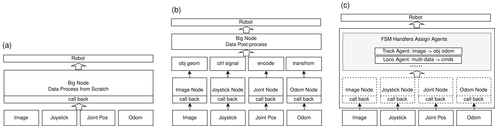

# ROS Base

ROS Base is a lightweight Python framework for building ROS 2 applications with
clear module boundaries. It provides reusable base classes for organizing a robot
program around four roles:

- `BaseManager`: the main ROS 2 node and runtime coordinator.
- `BaseNode`: ROS communication and hardware/software I/O wrappers.
- `BaseAgent`: compute-heavy or algorithmic modules.
- `BaseHandlers`: task logic, state machines, and high-level orchestration.

The full design notes and tutorials are maintained on the ROS Base documentation
website. This README is intended as a quick project entry point.



## Documentation and Real Application Example

- ROS Base documentation website:
  - English: <https://11chens.github.io/ros_base_doc/en/>
  - Chinese: <https://11chens.github.io/ros_base_doc/>
- Full application example: [`SigLoMa-Code`](https://github.com/11chens/SigLoMa-Code)

`SigLoMa-Code` is the public entry repository for a real robot system built on
top of ROS Base. It connects training code, VLM task orchestration, quadruped
locomotion deployment, Kalman-filter integration, hardware notes, and real-robot
deployment into one reproducible workflow. If you want to learn how ROS Base is
used beyond toy examples, SigLoMa is the recommended project to study.

Related reusable repositories:

- [`quad_deploy`](https://github.com/11chens/quad_deploy): reusable quadruped RL deployment framework built on ROS Base.
- [`KalmanFilter`](https://github.com/11chens/KalmanFilter): standalone Kalman-filter development, simulation, and robot-system integration.

## Requirements

- Python 3.6+
- ROS 2 Python environment with `rclpy`
- `tmux` if you use `ros_base.launch.base_launcher`
- `pyyaml` if you use YAML launcher configs

`rclpy` is expected to come from your ROS 2 installation or RoboStack
environment, not from `pip`.

## Installation

Install ROS Base in editable mode:

```bash
cd ~/Projects
git clone git@github.com:11chens/ros_base.git
cd ros_base
pip install -e .
```

Before running ROS 2 programs, source your ROS environment as usual, for example:

```bash
source /opt/ros/humble/setup.bash
```

If you use RoboStack or another virtual environment, activate that environment
first.

## Minimal Usage

A typical ROS Base application defines nodes for communication, agents for
computation, handlers for task flow, and a manager to run them.

```python
import rclpy
from std_msgs.msg import String

from ros_base.handlers.base_handlers import BaseHandlers
from ros_base.manager.base_manager import BaseManager
from ros_base.nodes.base_node import BaseNode


class TalkerNode(BaseNode):
    def __init__(self, *args, **kwargs):
        super().__init__(*args, **kwargs)
        self.pub = self.create_publisher(String, "/hello", 10)

    def publish(self, text: str):
        msg = String()
        msg.data = text
        self.pub.publish(msg)


class DemoHandlers(BaseHandlers):
    def handle(self):
        self.nodes["talker"].publish(f"tick {self.timestamp}")


def main():
    rclpy.init()
    manager = BaseManager(
        node_name="demo_manager",
        nodes_dict={"talker": TalkerNode},
        handlers_class=DemoHandlers,
        node_freq_hz=10,
    )
    manager.start_main_loop_timer()


if __name__ == "__main__":
    main()
```

Run it as a normal Python ROS 2 program:

```bash
python demo_manager.py
```

## Standalone Nodes

`BaseNode` can also be used without a manager. This is useful for testing a
single hardware driver or subscriber/publisher in isolation.

```python
import rclpy

from my_project.nodes import CameraNode

rclpy.init()
node = CameraNode(node_name="camera_node")
node.start_spin_standalone()
```

When a node is registered by `BaseManager`, it shares the manager's ROS node and
can access sibling modules through `self.nodes` and `self.agents`.

## Launcher

ROS Base includes a small tmux-based process launcher for multi-process robot
systems:

```bash
python ros_base/launch/base_launcher.py path/to/launch_cfg.yaml
```

Example config:

```yaml
env:
  session_name: demo_robot
  workspace_root: ~/Projects
  ros_setup: /opt/ros/humble/setup.bash
  conda_env: robot

nodes:
  - name: perception
    project: perception_project
    command: python scripts/perception_node.py
    cpus: "0-3"
    autostart: true

  - name: controller
    project: control_project
    command: python scripts/controller.py
    cpus: "4-7"
    autostart: true
```

Useful tmux commands:

```bash
tmux attach -t demo_robot
tmux kill-session -t demo_robot
```

You can selectively enable or disable nodes:

```bash
python ros_base/launch/base_launcher.py launch_cfg.yaml --disable perception
python ros_base/launch/base_launcher.py launch_cfg.yaml --enable controller
```

In the SigLoMa deployment stack, this launcher pattern is used to coordinate
`quad_deploy`, `SigLoMa-VLM`, ROS Base nodes, and the VSLAM session from one
entrypoint. See [`SigLoMa-Code`](https://github.com/11chens/SigLoMa-Code) for
the full real-robot workflow.

## Package Layout

```text
ros_base/
|-- agents/       # BaseAgent and algorithm modules
|-- handlers/     # BaseHandlers and task/state-machine logic
|-- launch/       # tmux launcher utilities
|-- manager/      # BaseManager runtime
|-- nodes/        # BaseNode and reusable ROS I/O modules
`-- utils/        # logging, math, camera, debug, and visualization helpers
```

## Development

Install the project locally, make focused changes, and run the relevant robot
program or downstream project that depends on the changed module. For formatting
and static checks, use the repository pre-commit configuration:

```bash
pre-commit install
pre-commit run --all-files
```

## License

See [LICENSE](LICENSE).
